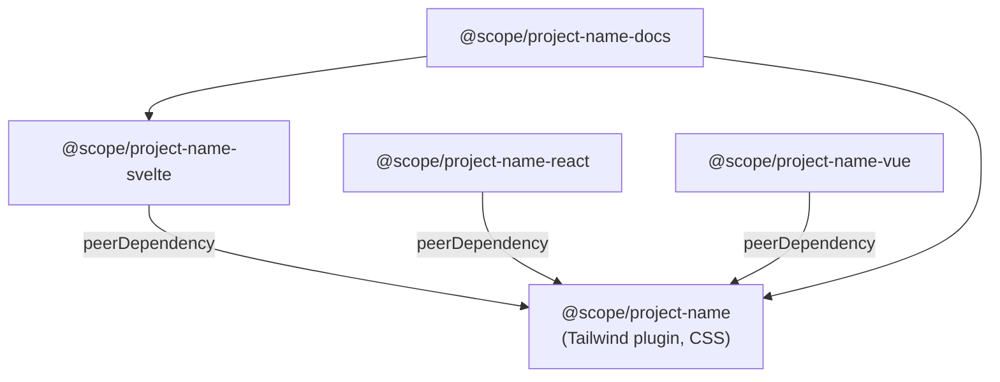
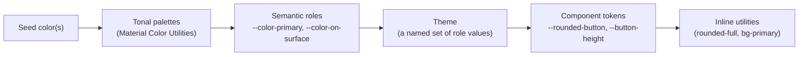

# 00 — Overview & Architecture

This chapter explains _what_ the system is and _why_ each decision was made,
before any code exists. Read it once; the rest of the handbook builds on the
vocabulary and reasoning established here.

## 1. The shape of the system

```
repository root
├── packages/
│   ├── project-name/        → @scope/project-name        (Tailwind v4 plugin)
│   ├── svelte/              → @scope/project-name-svelte  (Svelte 5 components)
│   ├── react/              → @scope/project-name-react   (React 19 components)
│   ├── vue/                → @scope/project-name-vue     (Vue 3 components)
│   └── docs/               → @scope/project-name-docs    (SvelteKit docs site)
├── .github/                 → workflows, templates, automation
├── .changeset/              → pending version bumps
└── handbook/                → this documentation
```

The dependency graph is deliberately a shallow tree:



- The **plugin** depends on nothing in the repo. It is the root of the graph.
- Each **framework library** declares the plugin as a **peer dependency** — the
  consumer installs both, and the library never bundles a copy of the plugin.
- The **docs site** consumes everything, but is never published.

## 2. Why a plugin owns all the styling

The single most important architectural decision: **all visual design lives in
the Tailwind plugin, expressed as CSS**, and the framework libraries emit only
class names.

Consider a button. The _look_ of a button — its padding, radius, color roles,
hover and focus states, elevation — is identical whether it is rendered by
Svelte, React, or Vue. Only the _behavior_ (event wiring, slots/children,
accessibility attributes, ripple effects) differs per framework.

So we split the concerns:

| Concern                | Lives in               | Example                                        |
| ---------------------- | ---------------------- | ---------------------------------------------- |
| Color, spacing, radius | Plugin (design tokens) | `--color-primary`, `--rounded-button`          |
| Component look         | Plugin (component CSS) | `.button`, `.button-filled`, `.button-primary` |
| Component behavior     | Framework library      | `onclick`, ripple, `aria-pressed`              |
| Composition & pages    | Docs / consumer app    | `<Button variant="filled">Save</Button>`       |

The payoff:

1. **One source of truth for design.** Change `--rounded-button` once; every
   framework and every consumer updates.
2. **Framework libraries are tiny.** A `Button.svelte` is a `<button>` that
   spreads props and computes a class string. No design lives in it.
3. **Consumers can opt out of components entirely.** A team using plain HTML
   still gets the whole design system by installing only the plugin.
4. **Cross-framework parity is structural, not aspirational.** The React button
   _cannot_ drift from the Svelte button's appearance, because neither owns the
   appearance.

## 3. Why Tailwind v4, and why a _plugin_ rather than a stylesheet

Tailwind CSS v4 moved configuration into CSS itself (`@theme`, `@plugin`,
`@utility`, `@variant`, `@layer`). A v4 **plugin** can register:

- **Design tokens** as CSS custom properties and as Tailwind theme values (so
  `bg-primary`, `text-on-surface`, `rounded-button` all "just work").
- **Component classes** (`.button`, `.card`) in a cascade layer.
- **Custom variants** (`interactive:`, `elevated:`).
- **`@property` registrations** for typed custom properties used in animations.

Crucially, a plugin is evaluated **inside the consumer's own Tailwind build**.
That is why the plugin ships _logic that produces CSS_, not a pre-built
stylesheet: Tailwind must process `@theme`/`@layer` in the context of the app
that consumes it, so tree-shaking and the consumer's own utilities interleave
correctly.

> **Consequence.** The plugin package has no "bundle a big CSS file" step in the
> traditional sense. Instead it authors CSS in `src/`, _compiles that CSS into
> data_ (`generated/*.ts`), and ships small runtime code that hands that data to
> Tailwind's plugin API. [02-plugin-package.md](02-plugin-package.md) builds
> this pipeline step by step.

## 4. Technology choices and the reasoning

| Area              | Choice                                         | Why                                                                                    |
| ----------------- | ---------------------------------------------- | -------------------------------------------------------------------------------------- |
| Package manager   | **Bun** workspaces                             | Fast installs, built-in test runner and TS execution, `--filter` for per-package runs. |
| Language          | **TypeScript** everywhere                      | Types across the build pipeline catch generated/runtime mismatches at compile time.    |
| CSS engine        | **Tailwind CSS v4**                            | CSS-native config, `@plugin`, layers, and first-class custom properties.               |
| Color engine      | **Material Color Utilities**                   | Generates tonal palettes and accessible role colors from a single seed color.          |
| Svelte build      | **`@sveltejs/package`**                        | The canonical way to publish Svelte components with correct export maps.               |
| React build       | **`tsup`** (esbuild) + `tsc`                   | Fast ESM/CJS output; `tsc` emits `.d.ts`.                                              |
| Vue build         | **Vite library mode** + `vue-tsc`              | Compiles SFCs and emits types.                                                         |
| Docs framework    | **SvelteKit**                                  | SSR + routing; the same team already maintains the Svelte library.                     |
| Versioning        | **Changesets**                                 | Human-authored intent files → SemVer bumps + changelogs + lockstep publishing.         |
| Commit convention | **Conventional Commits**                       | Machine-readable history; feeds tooling and release notes.                             |
| CI/CD             | **GitHub Actions**                             | Native to the host; matrix builds; official Changesets and deploy actions.             |
| Docs hosting      | **Cloudflare Workers** and/or **GitHub Pages** | Two independent, documented paths; pick one or run both.                               |

You can substitute pieces (pnpm for Bun, Vitest for `bun test`, etc.); each
chapter notes where a substitution changes the instructions.

## 5. The design-token layering model

Tokens flow from most generic to most specific, and each layer can override the
one above it. This is the mental model behind [02-plugin-package.md](02-plugin-package.md)
and the theme generator in [06-docs-site.md](06-docs-site.md).



A concrete example that recurs throughout the handbook — **border-radius
resolution for a button**, in ascending priority:

1. `--rounded-field` — the default radius for all _field-like_ elements.
2. `--rounded-button` — a button-specific radius; **falls back to
   `--rounded-field`** when a theme does not set it, and **overrides it** when a
   theme does.
3. An **inline utility** such as `rounded-full` — overrides both.

In CSS this is a fallback chain:

```css
.button {
	/* inline `rounded-*` wins because Tailwind's utility comes later in the
     cascade and sets border-radius directly; the custom-property chain below
     supplies the default when no utility is present. */
	border-radius: var(--rounded-button, var(--rounded-field));
}
```

Understanding this ordering is the key to the plugin, the themes, and the
generator all at once.

## 6. What "done" looks like

By the end of this handbook you will have:

- A repo that installs with one command and runs the docs site with another.
- Three publishable framework libraries and one publishable plugin, all
  versioned in lockstep by Changesets.
- Green CI on every PR, automated npm publishing on merge, and the docs site
  auto-deploying to Cloudflare and/or GitHub Pages.
- A roadmap you can import into GitHub as milestones and issues.
- AI-agent scaffolding so Claude Code, Copilot, and Cursor all understand the
  repo's conventions.
- One-key debugging of the docs site — browser and server — inside VS Code.

Next: [01-monorepo-setup.md](01-monorepo-setup.md).
