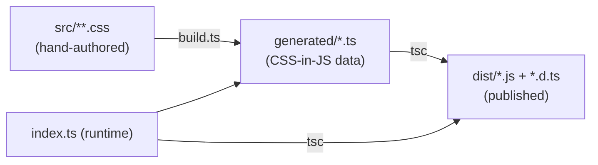

# 02 — The Tailwind CSS v4 Plugin (`@scope/project-name`)

This is the heart of the system and the longest chapter. The plugin owns every
design token, every theme, and every component's CSS. The framework libraries in
later chapters are thin wrappers around the class names produced here.

By the end you will have a package that:

- Authors component CSS in `src/` as ordinary, readable stylesheets.
- **Compiles that CSS into TypeScript data** (`generated/*.ts`) at build time.
- Ships a small runtime that hands that data to Tailwind's plugin API.
- Exposes design tokens as both CSS variables and Tailwind theme values.
- Ships multiple named themes and lets consumers define their own.
- Implements the layered border-radius resolution from
  [00-overview.md](00-overview.md#5-the-design-token-layering-model).

## 1. Why compile CSS into data instead of shipping CSS

A Tailwind v4 plugin runs **inside the consumer's build**. It cannot ship a
finished stylesheet, because `@theme`, `@layer`, and `@utility` must be processed
in the consumer's own Tailwind context so that tree-shaking and the consumer's
utilities interleave correctly.

So the plugin ships _code that produces CSS-in-JS objects_, which it registers
through the plugin API (`addBase`, `addUtilities`, `addVariant`, `matchUtilities`,
`addComponents`). We still want to **author** in real CSS — it is far more
readable than nested JS objects — so we add a compile step:



- **`src/`** — you edit this. Plain CSS, split by concern.
- **`generated/`** — produced by `build.ts`; never edited by hand. Committed so
  GitHub readers and CI see real files (see the note in
  [01-monorepo-setup.md](01-monorepo-setup.md#2-declare-the-workspace)).
- **`dist/`** — produced by `tsc`; the only thing published to npm.

## 2. Package scaffold

```sh
cd packages
mkdir project-name && cd project-name
```

`packages/project-name/package.json`:

```jsonc
{
	"name": "@scope/project-name",
	"version": "0.0.0",
	"description": "Tailwind CSS v4 plugin: components, foundations, themes, and design tokens.",
	"type": "module",
	"repository": {
		"type": "git",
		"url": "git+https://github.com/your-org/project-name.git",
		"directory": "packages/project-name"
	},
	"scripts": {
		"dev": "bun functions/watch.ts",
		"build": "bun functions/build.ts && tsc -p tsconfig.build.json",
		"typecheck": "tsc -p tsconfig.json --noEmit",
		"test:unit": "bun test test/unit",
		"test:e2e": "bun test/e2e.test.ts",
		"test": "bun run test:unit && bun run test:e2e",
		"check": "bun run build && bun run typecheck && bun run test && publint",
		"package": "bun run build && npm pack --pack-destination ../../build"
	},
	"files": ["dist", "README.md"],
	"types": "./dist/index.d.ts",
	"exports": {
		".": { "types": "./dist/index.d.ts", "default": "./dist/index.js" },
		"./theme": { "types": "./dist/theme.d.ts", "default": "./dist/theme.js" },
		"./themes": { "types": "./dist/themes.d.ts", "default": "./dist/themes.js" },
		"./package.json": "./package.json"
	},
	"publishConfig": { "access": "public", "registry": "https://registry.npmjs.org" },
	"dependencies": {
		"@material/material-color-utilities": "^0.3.0"
	},
	"peerDependencies": { "tailwindcss": "^4.0.0" },
	"devDependencies": {
		"@types/bun": "latest",
		"@types/node": "^20",
		"postcss": "^8.4.0",
		"postcss-js": "^4.0.1",
		"publint": "^0.3.0",
		"tailwindcss": "^4.0.0",
		"typescript": "^5.7.0"
	},
	"keywords": ["tailwindcss", "tailwind-plugin", "design-system", "ui"]
}
```

Notes on the manifest:

- **`peerDependencies.tailwindcss`** — the consumer supplies Tailwind; you do not
  bundle it. Listed in `devDependencies` too so you can build and test locally.
- **`exports`** — three public entry points: the plugin itself (`.`), a
  theme-authoring helper (`./theme`), and the shipped theme set (`./themes`). The
  `./package.json` export lets tooling (like `publint`) read the manifest.
- **`files: ["dist", "README.md"]`** — only compiled output is published; `src/`
  and `generated/` stay in the repo.
- **`postcss` + `postcss-js`** — used by the build to parse authored CSS into the
  CSS-in-JS object shape Tailwind's plugin API expects.

Two TypeScript configs:

`tsconfig.json` (editor + typecheck, checks the whole package):

```jsonc
{
	"extends": "../../tsconfig.base.json",
	"compilerOptions": { "types": ["bun", "node"], "noEmit": true },
	"include": ["index.ts", "theme.ts", "themes.ts", "types.ts", "functions", "generated", "test"]
}
```

`tsconfig.build.json` (emits `dist/` from the runtime + generated data only):

```jsonc
{
	"extends": "../../tsconfig.base.json",
	"compilerOptions": {
		"outDir": "dist",
		"rootDir": ".",
		"types": ["node"],
		"declaration": true
	},
	"include": ["index.ts", "theme.ts", "themes.ts", "types.ts", "generated"]
}
```

> **Why `generated/` is in the build `include`.** Compiling the runtime _together_
> with the generated data means `tsc` type-checks your hand-written `index.ts`
> against the _actual shape_ of what `build.ts` produced. If codegen and runtime
> drift, the build fails instead of shipping broken types.

## 3. Authoring CSS in `src/`

Split source by concern:

```
src/
├── base/           # design tokens: colors, spacing, radii, elevation, motion
│   ├── tokens.css
│   ├── properties.css   # @property registrations for animatable custom props
│   └── reset.css
├── utilities/      # custom @utility definitions and @variant declarations
│   └── variants.css
├── components/     # one file per component
│   ├── button.css
│   ├── card.css
│   └── ...
└── themes/         # one file per shipped theme
    ├── default.css
    ├── ocean.css
    └── ...
```

### 3.1 Design tokens

`src/base/tokens.css` declares the system's variables. Group them by role:

```css
@theme {
	/* Shape — the radius scale the whole system references. */
	--rounded-none: 0px;
	--rounded-sm: 0.25rem;
	--rounded-field: 0.5rem; /* default radius for field-like elements */
	--rounded-lg: 1rem;
	--rounded-full: 9999px;

	/* Spacing, typography, elevation, motion … */
	--elevation-1: 0 1px 2px rgb(0 0 0 / 0.08);
	--duration-fast: 120ms;
	--ease-standard: cubic-bezier(0.2, 0, 0, 1);
}
```

Values placed in `@theme` become **both** CSS custom properties **and** Tailwind
theme entries — so `--rounded-lg` yields the `rounded-lg` utility automatically,
and `--color-primary` (set per theme, below) yields `bg-primary`, `text-primary`,
`border-primary`, and so on.

### 3.2 `@property` registrations

Animatable custom properties must be registered so the browser can interpolate
them. `src/base/properties.css`:

```css
@property --interactive {
	syntax: '<integer>';
	inherits: false;
	initial-value: 0;
}
@property --ripple-scale {
	syntax: '<number>';
	inherits: false;
	initial-value: 0;
}
```

The build extracts these and emits them via `addBase` unconditionally (Tailwind
would otherwise usage-gate them away).

### 3.3 A component: the button (with layered radius)

This is the concrete example the whole handbook returns to.
`src/components/button.css`:

```css
@layer components {
	.button {
		display: inline-flex;
		align-items: center;
		justify-content: center;
		gap: 0.5rem;
		height: var(--button-height, 2.5rem);
		padding-inline: 1rem;

		/*
      Border-radius resolution, lowest priority first:
        1. --rounded-field   default for all field-like elements
        2. --rounded-button  button-specific; overrides field when a theme
                             sets it, falls back to field when it does not
      An inline utility (e.g. `rounded-full`) beats both because Tailwind emits
      it in the utilities layer, which cascades after this components layer.
    */
		border-radius: var(--rounded-button, var(--rounded-field));

		transition: background-color var(--duration-fast) var(--ease-standard);
	}

	/* Variants describe fill/emphasis; color roles are applied separately so any
     variant can pair with any role. */
	.button-filled {
		background: var(--color-primary);
		color: var(--color-on-primary);
	}
	.button-outline {
		background: transparent;
		border: 1px solid currentColor;
	}
	.button-primary {
		--color-primary: var(--color-primary);
	}
	.button-secondary {
		--color-primary: var(--color-secondary);
	}
}
```

Usage in any framework is then `class="button button-filled button-primary"`,
and `class="button button-filled button-primary rounded-full"` overrides the
radius inline — exactly the priority order specified in the requirements.

> **Setting `--rounded-button` in a theme.** Because `--rounded-button` is read
> with a fallback to `--rounded-field`, a theme opts in simply by declaring it:
> `:root { --rounded-button: 9999px; }` makes every button pill-shaped
> system-wide, while a theme that stays silent inherits `--rounded-field`.

### 3.4 Custom utilities and variants

`src/utilities/variants.css`:

```css
/* A variant that targets elements the runtime has marked interactive. */
@variant interactive (&:where([style*='--interactive: 1']));

/* A functional utility with an arbitrary value, e.g. `tooltip-gap-2`. */
@utility tooltip-gap-* {
	--tooltip-gap: --value(--spacing-*);
}
```

## 4. The compile pipeline (`functions/build.ts`)

`build.ts` reads `src/**`, parses each stylesheet, and writes `generated/*.ts`.
Structure it as a series of pure extraction functions so each is unit-testable.

`functions/build.ts` (abridged to show the flow):

```ts
import fs from 'node:fs';
import path from 'node:path';
import { fileURLToPath } from 'node:url';
import postcss from 'postcss';
import postcssJs from 'postcss-js';

const here = path.dirname(fileURLToPath(import.meta.url));
const pkg = path.resolve(here, '..');
const srcDir = path.join(pkg, 'src');
const outDir = path.join(pkg, 'generated');

/** Parse a CSS file into the CSS-in-JS object Tailwind's plugin API expects. */
function cssToObject(file: string): Record<string, unknown> {
  const root = postcss.parse(fs.readFileSync(file, 'utf8'));
  return postcssJs.objectify(root);
}

/** Serialize a JS value as a typed ES module. */
function emit(name: string, value: unknown): void {
  const body = `// AUTO-GENERATED by functions/build.ts. Do not edit.\n`
    + `export default ${JSON.stringify(value, null, 2)} as const;\n`;
  fs.writeFileSync(path.join(outDir, `${name}.ts`), body);
}

function build(): void {
  fs.mkdirSync(outDir, { recursive: true });

  // 1. Tokens → theme.extend entries + raw custom properties.
  emit('theme',      extractThemeVariables(cssToObject(path.join(srcDir, 'base/tokens.css'))));
  emit('properties', extractProperties(path.join(srcDir, 'base/properties.css')));

  // 2. Components → one bundle each, split by plugin channel.
  const components = fs.readdirSync(path.join(srcDir, 'components'))
    .filter((f) => f.endsWith('.css'));
  emit('components', Object.fromEntries(
    components.map((f) => [f.replace('.css', ''), partition(cssToObject(path.join(srcDir, 'components', f)))])
  ));

  // 3. Variants and functional utilities.
  emit('variants',   extractVariants(path.join(srcDir, 'utilities/variants.css')));
  emit('functional', extractFunctional(path.join(srcDir, 'utilities/variants.css')));

  // 4. Themes → palettes keyed by theme id then selector.
  emit('themes', buildThemes(path.join(srcDir, 'themes')));

  console.log('generated/ rebuilt');
}

build();
```

Each `extract*`/`partition`/`buildThemes` helper lives in its own file under
`functions/` and has a matching test under `test/unit/`. Keeping them pure — CSS
object in, plain data out — is what makes the pipeline trustworthy.

> **`partition`** splits a component's rules by the plugin channel they need:
> `@utility` rules (Tailwind wraps them in `@layer utilities`, usage-gated),
> plain selector rules (emitted in a components layer), and rules for classes
> written at runtime that Tailwind can never see as candidates (emitted
> unconditionally via `addBase`). This distinction matters for anything created
> imperatively, like a ripple element.

## 5. Themes and Material Color Utilities

A **theme** is a named set of role-color values. Generate accessible palettes
from a seed color with `@material/material-color-utilities`.

`functions/generate-theme.ts` (also reused by the docs generator in
[06-docs-site.md](06-docs-site.md)):

```ts
import {
  argbFromHex, themeFromSourceColor, hexFromArgb
} from '@material/material-color-utilities';

export interface RoleColors {
  '--color-primary': string;
  '--color-on-primary': string;
  '--color-surface': string;
  '--color-on-surface': string;
  // …every role your system defines
}

/** Turn a single seed color into a full set of light/dark role colors. */
export function rolesFromSeed(seedHex: string, dark = false): RoleColors {
  const theme = themeFromSourceColor(argbFromHex(seedHex));
  const scheme = dark ? theme.schemes.dark : theme.schemes.light;
  return {
    '--color-primary': hexFromArgb(scheme.primary),
    '--color-on-primary': hexFromArgb(scheme.onPrimary),
    '--color-surface': hexFromArgb(scheme.surface),
    '--color-on-surface': hexFromArgb(scheme.onSurface),
    // …
  };
}
```

The build wraps these into selectors. The `default` theme sits at
`:where(:root)` with **zero specificity** so it supplies fallback values every
other theme inherits for roles it does not override:

```ts
// generated/themes.ts (shape)
export default {
  default: { ':where(:root)': { '--color-primary': '#4f46e5', /* … */ } },
  ocean:   { "[data-theme='ocean']": { '--color-primary': '#0ea5e9' } }
} as const;
```

> **Why `default` is always shipped.** Other themes only set the roles they
> change; they rely on `default` for the rest. The plugin therefore always
> includes `default` even when a consumer requests a subset — dropping it would
> leave other themes with unresolved colors. This is enforced in the runtime
> below.

## 6. The runtime (`index.ts`)

`index.ts` is the published entry point. It reads the generated data and
registers it through Tailwind's plugin API, honoring options.

`packages/project-name/index.ts`:

```ts
import plugin from 'tailwindcss/plugin';
import type { PluginAPI } from 'tailwindcss/plugin';

import theme from './generated/theme.js';
import properties from './generated/properties.js';
import components from './generated/components.js';
import variants from './generated/variants.js';
import themes from './generated/themes.js';

export interface PluginOptions {
  /** Prefix component classes and variables, e.g. `prefix: 'ui-'`. */
  prefix?: string;
  /** Only include these components. */
  include?: string | string[];
  /** Include everything except these. */
  exclude?: string | string[];
  /** Which themes to ship. `default` is always included. */
  themes?: string | string[];
  /** Override shape tokens globally, e.g. `'--rounded-button': '9999px'`. */
  [token: `--${string}`]: string | number | undefined;
}

export default plugin.withOptions<PluginOptions>((options = {}) => {
  const { prefix = '', include, exclude } = options;
  const included = (name: string): boolean => {
    if (include) return ([] as string[]).concat(include).includes(name);
    if (exclude) return !([] as string[]).concat(exclude).includes(name);
    return true;
  };

  // Validate requested themes; always keep `default`.
  const requested = options.themes == null ? null : ([] as string[]).concat(options.themes);
  const unknown = requested?.filter((t) => !(t in themes)) ?? [];
  if (unknown.length) {
    throw new Error(`project-name: unknown theme(s) ${unknown.join(', ')}. `
      + `Shipped: ${Object.keys(themes).join(', ')}.`);
  }
  const selected = requested === null
    ? Object.keys(themes)
    : [...new Set(['default', ...requested])];

  return (api: PluginAPI) => {
    api.addBase(properties);                       // @property registrations
    for (const t of selected)
      for (const [sel, decls] of Object.entries(themes[t]))
        api.addBase({ [sel]: decls });             // theme role colors

    for (const [name, selector] of Object.entries(variants))
      api.addVariant(`${prefix}${name}`, selector);

    for (const [name, bundle] of Object.entries(components)) {
      if (!included(name)) continue;
      api.addComponents(withPrefix(bundle.standalone, prefix));
      api.addUtilities(withPrefix(bundle.utilities, prefix));
      api.addBase(bundle.unconditional);           // runtime-created classes
    }
  };
}, () => ({
  // Register token values as Tailwind theme entries so bg-primary etc. exist.
  theme: { extend: theme }
}));
```

`withPrefix` is a small helper that rewrites only the names the plugin owns
(tracked in a generated `registry`), so a consumer's `prefix: 'ui-'` renames
`.button` to `.ui-button` without touching unrelated selectors.

`theme.ts` and `themes.ts` are tiny re-export modules for the `./theme` and
`./themes` entry points (theme-authoring helper and the shipped palette set).

## 7. Watch mode (`functions/watch.ts`)

During development the docs site needs the plugin to rebuild `generated/` when
you edit `src/`. `functions/watch.ts` does exactly that — and nothing more:

```ts
import { execFileSync } from 'node:child_process';
import fs from 'node:fs';
import path from 'node:path';
import { fileURLToPath } from 'node:url';

const here = path.dirname(fileURLToPath(import.meta.url));
const pkg = path.resolve(here, '..');
const build = path.join(here, 'build.ts');
const entry = path.join(pkg, 'index.ts');

function rebuild() {
  execFileSync(process.execPath, [build], { cwd: pkg, stdio: 'inherit' });
  // Touch the entry so a consumer's Tailwind (which tracks the @plugin file's
  // mtime) recompiles. generated/ is where the change actually landed, and
  // Tailwind does not follow the entry's imports.
  const now = new Date();
  fs.utimesSync(entry, now, now);
}

rebuild();
const watched = [path.join(pkg, 'src'), here];
for (const dir of watched)
  fs.watch(dir, { recursive: true }, debounce(rebuild, 80));
```

It deliberately does **not** run `tsc`: `dist/` is not read in the dev loop, and
skipping it roughly triples turnaround. The clever half — getting the consumer's
Tailwind to notice the rebuild — is completed on the docs side in
[06-docs-site.md](06-docs-site.md#3-live-reloading-the-plugin).

## 8. Tests

Two layers, both run by `bun test`:

- **Unit** (`test/unit/*.test.ts`) — feed each `extract*`/`partition` function a
  CSS snippet, assert the emitted data. Fast, no Tailwind.
- **E2E** (`test/e2e.test.ts`) — run the real Tailwind CLI over a fixture that
  uses the plugin, and assert the compiled CSS contains the expected rules (for
  example that `.button` resolves `border-radius` to the fallback chain, and that
  `exclude: ['button']` drops it).

```ts
// test/e2e.test.ts (shape)
import { test, expect } from 'bun:test';
import { execFileSync } from 'node:child_process';

test('button ships its radius fallback chain', () => {
  const css = execFileSync('bunx', ['@tailwindcss/cli', '-i', 'test/fixtures/app.css'], { encoding: 'utf8' });
  expect(css).toContain('var(--rounded-button, var(--rounded-field))');
});
```

## 9. Building, linting the package surface, and packing

```sh
bun run build     # generated/ → dist/ (+ .d.ts)
bun run check     # build + typecheck + tests + publint
```

**`publint`** validates the published surface: that `exports`, `types`, and
`files` agree and that the package is consumable from ESM. Run it in `check` so a
broken export map fails locally, not after publishing.

`bun run package` produces a real tarball in `build/` (via `npm pack`) so you can
`npm install ../../build/scope-project-name-x.y.z.tgz` in a scratch app and
verify the _installed_ experience before releasing.

## 10. The consumer's experience

What a consumer writes after `npm install @scope/project-name`:

```css
/* app.css */
@import 'tailwindcss';

@plugin '@scope/project-name' {
	prefix: ui-; /* optional */
	themes: default, ocean; /* optional; default always included */
	exclude: badge; /* optional */
	--rounded-button: 9999px; /* optional global shape override */
}
```

No CSS `@import` from the plugin is needed — the tokens the components depend on
ship _with_ the plugin and are registered through `addBase`.

## Checklist

- [ ] `package.json` with `peerDependencies.tailwindcss`, three export entries,
      `files: ["dist", …]`.
- [ ] `src/` authored CSS split into base / utilities / components / themes.
- [ ] `functions/build.ts` compiles `src/` → `generated/*.ts` via pure helpers.
- [ ] `index.ts` registers generated data through the plugin API and honors
      `prefix`/`include`/`exclude`/`themes` and shape-token overrides.
- [ ] Button implements `var(--rounded-button, var(--rounded-field))` with inline
      utilities overriding both.
- [ ] `functions/watch.ts` rebuilds `generated/` and touches the entry.
- [ ] Unit + E2E tests pass; `publint` clean.

Next: [03-svelte-package.md](03-svelte-package.md).
