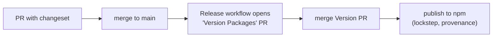

# 11 — Conventions: SemVer, Commits, Changelogs & Releases

This chapter defines how the project versions, how commits are written, how
changelogs are generated, and how VS Code and Git enforce all of it. The plumbing
was installed in [01-monorepo-setup.md](01-monorepo-setup.md#9-git-hooks-husky--lint-staged--commitlint);
here is the full policy and rationale.

## 1. Semantic Versioning

Published packages follow [SemVer](https://semver.org): `MAJOR.MINOR.PATCH`.

| Bump  | When                               | Example            |
| ----- | ---------------------------------- | ------------------ |
| MAJOR | A breaking change to a public API. | Remove a prop.     |
| MINOR | A backward-compatible feature.     | Add a component.   |
| PATCH | A backward-compatible bug fix.     | Fix a hover color. |

During `0.x`, treat **minor** as "may break" and **patch** as "safe" — SemVer's
special pre-1.0 rule. The jump to `1.0.0` is the stability promise
([07-issues-milestones.md](07-issues-milestones.md) milestone M7).

### Lockstep versioning

The plugin and the three framework libraries are versioned **in lockstep**: they
always share a version number. This is deliberate — a Svelte component that relies
on a new plugin class must not be installable next to an older plugin. Lockstep
makes the compatible set obvious: same version across all four. Configured in §4.

## 2. Conventional Commits

Every commit message follows [Conventional Commits](https://www.conventionalcommits.org):

```
type(scope): summary

[optional body]

[optional footer(s)]
```

- **`type`** — one of: `feat`, `fix`, `docs`, `style`, `refactor`, `perf`,
  `test`, `build`, `ci`, `chore`, `revert`.
- **`scope`** — the affected area: `plugin`, `svelte`, `react`, `vue`, `docs`,
  `ci`, `build`, or a component name.
- **Breaking changes** — either a `!` after the type/scope
  (`feat(plugin)!: ...`) or a `BREAKING CHANGE:` footer. Either triggers a MAJOR
  bump.

Examples:

```
feat(svelte): add Tooltip component
fix(plugin): resolve --rounded-button fallback when theme omits it
docs(themes): document the theme generator
feat(plugin)!: rename --radius-field to --rounded-field

BREAKING CHANGE: consumers setting --radius-field must rename it.
```

### Why bother

Conventional Commits make history machine-readable. Tooling can derive the next
version and a categorized changelog from commits alone, PR titles can be linted,
and release notes stop being hand-written guesswork.

## 3. Two complementary systems: commitlint and Changesets

This project uses **both**, for different jobs:

- **commitlint** validates every _commit message_ against Conventional Commits
  (enforced by a git hook). It keeps history clean and reviewable.
- **Changesets** decides _version bumps and changelogs_ per release, from
  intent files contributors write. It drives publishing.

They are not redundant: commitlint governs the _history_, Changesets governs the
_release_. A team can use commit-derived versioning instead of Changesets (see
§7), but Changesets shines in a multi-package repo with lockstep versioning.

## 4. Changesets configuration

`.changeset/config.json`:

```jsonc
{
	"$schema": "https://unpkg.com/@changesets/config/schema.json",
	"changelog": "@changesets/changelog-github",
	"commit": false,
	"access": "public",
	"baseBranch": "main",
	// Lockstep: bump these four together to the same version.
	"linked": [
		[
			"@scope/project-name",
			"@scope/project-name-svelte",
			"@scope/project-name-react",
			"@scope/project-name-vue"
		]
	],
	// The docs site is private and never versioned/published.
	"ignore": ["@scope/project-name-docs"]
}
```

`@changesets/changelog-github` writes changelog entries that link back to the PR
and thank the author; it needs a `GITHUB_TOKEN` (present in Actions).

> **`linked` vs `fixed`.** `linked` bumps the group together _only when at least
> one of them changes_; `fixed` always bumps all of them on every release. For a
> tightly coupled set that should share a version, `linked` is usually right —
> unchanged packages still get bumped when any sibling in the group is released,
> keeping the numbers aligned.

## 5. The release workflow, end to end

1. **Author a change.** Make your code change.
2. **Add a changeset:**

   ```sh
   bun run changeset
   ```

   Pick the affected packages and the bump type; write a human sentence. This
   creates `.changeset/<random-name>.md`:

   ```markdown
   ---
   '@scope/project-name-svelte': minor
   ---

   Add a Tooltip component with `placement` and `delay` props.
   ```

   Because of `linked`, selecting one package bumps the whole group at release.

3. **Commit the changeset** alongside your code and open a PR.
4. **Merge to `main`.** The release workflow
   ([08-github-workflows.md](08-github-workflows.md#3-publishing-to-npm-with-changesets-releaseyml))
   opens a **"Version Packages" PR** that consumes all pending changesets, bumps
   versions, and updates each package's `CHANGELOG.md`.
5. **Merge the Version PR.** The workflow runs again and **publishes** the bumped
   packages to npm with provenance.



## 6. Changelogs

Each published package gets a `CHANGELOG.md` maintained by Changesets, grouped by
version with categorized entries and PR links. Because entries come from the
human sentence in each changeset, they read like release notes, not raw commit
logs.

To also cut a **GitHub Release** with those notes, add a step after publish that
reads the new `CHANGELOG.md` section and creates a release for the tag — or use
Changesets' tag output with `gh release create`. Example manual command:

```sh
gh release create @scope/project-name@1.3.0 \
  --title 'v1.3.0' \
  --notes-file packages/project-name/CHANGELOG-latest.md
```

## 7. Alternative: commit-derived versioning

If you prefer _not_ to write changeset files, you can derive versions and
changelogs from Conventional Commits directly with
[`release-please`](https://github.com/googleapis/release-please) or
[`semantic-release`](https://semantic-release.gitbook.io). Trade-off: less
explicit control over per-package bumps in a monorepo, but zero per-PR ceremony.
This handbook uses Changesets because lockstep, multi-package publishing is its
core use case — but the Conventional Commit history you keep either way makes
switching cheap.

## 8. Enforcing all of this in VS Code

Several layers, from soft nudge to hard block:

### 8.1 Git hooks (hard block, local)

Already wired in [01-monorepo-setup.md](01-monorepo-setup.md#9-git-hooks-husky--lint-staged--commitlint):
`commit-msg` runs `commitlint`, rejecting non-conforming messages before they are
recorded. This is the primary enforcement and works in any Git client, including
VS Code's Source Control panel.

### 8.2 A commit-message editor with guidance

Recommend the **Conventional Commits** VS Code extension
(`vivaxy.vscode-conventional-commits`) in `.vscode/extensions.json`. It adds a
Source Control command that walks you through type → scope → summary and writes a
correctly formatted message — so contributors do not have to memorize the grammar.

`.vscode/extensions.json` (add to the list from
[01-monorepo-setup.md](01-monorepo-setup.md#8-vs-code-workspace-settings)):

```json
{
	"recommendations": [
		"vivaxy.vscode-conventional-commits",
		"esbenp.prettier-vscode",
		"dbaeumer.vscode-eslint"
	]
}
```

### 8.3 A commit-message template (soft nudge)

Provide a template so the raw commit editor shows the grammar as a comment:

`.gitmessage.txt`:

```
# type(scope): summary  (<=72 chars)
#   type:  feat fix docs style refactor perf test build ci chore revert
#   scope: plugin svelte react vue docs ci build | component name
#
# Body: what & why (wrap at 72).
# Footer: BREAKING CHANGE: … | Closes #123
```

Point Git at it (document this in CONTRIBUTING):

```sh
git config commit.template .gitmessage.txt
```

### 8.4 CI enforcement (hard block, remote)

Add a PR check that lints commit messages _and_ the PR title (squash-merge uses
the PR title as the commit, so lint it too):

`.github/workflows/commitlint.yml`:

```yaml
name: Commit lint
on: [pull_request]
jobs:
  lint:
    runs-on: ubuntu-latest
    steps:
      - uses: actions/checkout@v4
        with: { fetch-depth: 0 }
      - uses: ./.github/actions/setup
      - name: Lint PR commits
        run: bunx commitlint --from ${{ github.event.pull_request.base.sha }} --to HEAD
      - name: Lint PR title
        run: echo "${{ github.event.pull_request.title }}" | bunx commitlint
```

### 8.5 A "changeset required" check

Fail PRs that touch a published package but add no changeset. The Changesets bot
(a GitHub App) comments on such PRs automatically; or add a step using
`changeset status --since=origin/main` that exits non-zero when a bump is missing.

## 9. Branch and merge policy

- **Squash merge** to `main`, using the PR title as the commit message (which the
  commitlint workflow validates). This keeps `main` history one clean
  Conventional Commit per change.
- Protect `main`: require CI + commitlint + review
  ([08-github-workflows.md](08-github-workflows.md#7-required-status-checks)).

## Checklist

- [ ] SemVer policy documented; plugin + 3 libraries versioned in lockstep.
- [ ] Conventional Commits enforced by `commit-msg` hook and a CI check.
- [ ] Changesets configured with `linked` group and docs ignored.
- [ ] Release flow: changeset → Version PR → npm publish with provenance.
- [ ] Changelogs auto-generated; optional GitHub Releases cut from them.
- [ ] VS Code: Conventional Commits extension + commit template recommended.
- [ ] Squash-merge; PR title linted; "changeset required" check active.

Next: [12-debugging.md](12-debugging.md).
