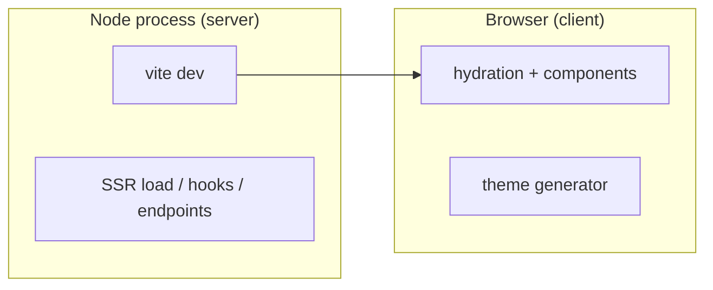

# 12 — Debugging the Docs Site in VS Code

The docs site is a SvelteKit app: it has a **server** side (SSR load functions,
endpoints, hooks) and a **client** side (components, the theme generator, browser
APIs). This chapter sets up debugging for **both**, entirely inside VS Code — set
a breakpoint, hit F5, and step through either half.

## 1. How the two halves map to processes



- **Server code** runs in the Node process started by `vite dev`. Debug it by
  attaching Node's inspector.
- **Client code** runs in the browser. Debug it by launching Chrome/Edge from VS
  Code with source maps.

VS Code can do both at once with a **compound** launch configuration.

## 2. Prerequisites

- The built-in **JavaScript Debugger** (ships with VS Code; no install).
- For rich `.svelte` breakpoints, the **Svelte for VS Code** extension
  (`svelte.svelte-vscode`) — already recommended in
  [01-monorepo-setup.md](01-monorepo-setup.md#8-vs-code-workspace-settings).
- Source maps on. Vite emits them in dev by default; ensure the docs
  `vite.config.ts` does not disable them.

## 3. `launch.json`

Create `.vscode/launch.json`. It defines three configs and one compound that runs
them together.

```jsonc
{
	"version": "0.2.0",
	"configurations": [
		{
			// SERVER: start `vite dev` under the Node debugger.
			"type": "node",
			"request": "launch",
			"name": "docs: server (vite dev)",
			"cwd": "${workspaceFolder}/packages/docs",
			"runtimeExecutable": "bun",
			"runtimeArgs": ["run", "dev"],
			"console": "integratedTerminal",
			"serverReadyAction": {
				// When Vite prints the URL, launch the client debugger against it.
				"pattern": "Local:\\s+(https?://\\S+)",
				"uriFormat": "%s",
				"action": "startDebugging",
				"name": "docs: client (browser)"
			}
		},
		{
			// CLIENT: open the site in Chrome/Edge with source maps.
			"type": "chrome", // use "msedge" for Edge
			"request": "launch",
			"name": "docs: client (browser)",
			"url": "http://localhost:5173",
			"webRoot": "${workspaceFolder}/packages/docs",
			"sourceMapPathOverrides": {
				"webpack://project-name-docs/*": "${workspaceFolder}/packages/docs/*"
			}
		},
		{
			// CLIENT (attach): attach to a Chrome you started with --remote-debugging-port=9222.
			"type": "chrome",
			"request": "attach",
			"name": "docs: client (attach 9222)",
			"port": 9222,
			"webRoot": "${workspaceFolder}/packages/docs"
		}
	],
	"compounds": [
		{
			"name": "docs: full stack",
			"configurations": ["docs: server (vite dev)"],
			"stopAll": true
		}
	]
}
```

Why it is shaped this way:

- **`runtimeExecutable: "bun"`** starts the dev server through Bun's runtime,
  which VS Code's Node debugger attaches to, so **server breakpoints work** in
  `+page.server.ts`, `+layout.server.ts`, `hooks.server.ts`, and endpoints.
- **`serverReadyAction`** watches the server's stdout for Vite's `Local:` URL and
  then automatically launches the **client** browser config against it — so the
  single compound "docs: full stack" boots the server _and_ the browser debugger.
  No need to run two configs by hand.
- **`stopAll`** tears down both when you stop debugging.

> **Bun vs Node.** If you prefer Node to run the dev server (some debugger
> features are most mature there), set `"runtimeExecutable": "node"` and
> `"runtimeArgs": ["node_modules/vite/bin/vite.js", "dev"]` with the same `cwd`.
> Everything else is identical.

## 4. Debugging server code

1. Open, say, `packages/docs/src/routes/themes/+page.server.ts` (a load function).
2. Set a breakpoint in the gutter.
3. Press **F5** and pick **"docs: full stack"** (or "docs: server").
4. Navigate to that route. Execution stops at your breakpoint; inspect
   `locals`, `params`, `fetch` results, step through, and use the Debug Console
   to evaluate expressions in the server context.

Server-side entry points you can break in:

- `+page.server.ts` / `+layout.server.ts` — `load` functions.
- `+server.ts` — endpoints (`GET`, `POST`).
- `hooks.server.ts` — `handle`, `handleFetch`, `handleError`.

## 5. Debugging client code

With the compound running, the browser launched by `serverReadyAction` is already
attached. Then:

1. Open a client file — a `.svelte` component, or `$lib/theme/generate.ts` (the
   theme generator logic from
   [06-docs-site.md](06-docs-site.md#6-the-live-theme-generator)).
2. Set a breakpoint.
3. Interact in the browser (e.g. change the seed color). Execution stops in VS
   Code with the browser's call stack, scopes, and variables.

For `.svelte` files, the Svelte extension maps compiled output back to your source
so breakpoints land on the line you set them on. If a breakpoint is "unbound",
it usually means the module has not loaded yet — trigger the route/interaction and
it will bind.

### Debugging the theme generator specifically

The generator is pure client logic plus clipboard access:

- Break inside `generateThemeCss` to inspect the Material Color Utilities output
  for a given seed.
- Break in the page's `$effect`/copy handler to verify the CSS string and
  clipboard call.
- Use the **Debug Console** to call `generateThemeCss({ seed: '#0ea5e9' })`
  directly and inspect the returned CSS without touching the UI.

## 6. Debugging tests

Add a config to step through Vitest/Bun tests:

```jsonc
{
	"type": "node",
	"request": "launch",
	"name": "debug: current test file",
	"cwd": "${workspaceFolder}",
	"runtimeExecutable": "bunx",
	"runtimeArgs": ["vitest", "run", "${relativeFile}"],
	"console": "integratedTerminal"
}
```

Open a `*.test.ts`, set a breakpoint, run this config. For plugin E2E tests that
shell out to the Tailwind CLI, break in the assertion to inspect the compiled CSS
string.

## 7. Source maps and common pitfalls

- **Breakpoints don't bind (server).** Ensure the server config uses the Node
  debugger (`type: "node"`) and that you launched via F5, not a plain terminal.
- **Breakpoints don't bind (client).** Confirm source maps are enabled and that
  `webRoot` points at `packages/docs`. Hard-reload the browser after (re)starting.
- **Workspace packages.** Because the docs alias the Svelte lib and plugin to
  **source** ([06-docs-site.md](06-docs-site.md#2-aliasing-workspace-packages-to-source)),
  you can set breakpoints directly in `packages/svelte/src/lib/**` and they bind
  while debugging the docs — no `dist/` in the way.
- **Two debuggers, one browser.** Do not also have `serverReadyAction` launch a
  browser _and_ run the standalone client config — you will open two windows.
  Use the compound (server only; it spawns the client) for the normal flow.

## 8. Quick reference

| I want to debug…                  | Config to run              | Where to break                                 |
| --------------------------------- | -------------------------- | ---------------------------------------------- |
| SSR load / endpoint / hook        | docs: full stack           | `*.server.ts`, `+server.ts`, `hooks.server.ts` |
| A component / browser interaction | docs: full stack           | `.svelte`, `$lib/**` client modules            |
| The theme generator               | docs: full stack           | `$lib/theme/generate.ts`, the page             |
| An already-open Chrome            | docs: client (attach 9222) | any client module                              |
| A unit/e2e test                   | debug: current test file   | the `*.test.ts`                                |

With this, the entire docs stack — server render, client hydration, the theme
generator, and the tests — is debuggable without leaving VS Code.

## Checklist

- [ ] `.vscode/launch.json` with server (Node), client (browser), attach, and a
      compound "docs: full stack".
- [ ] `serverReadyAction` auto-launches the browser from the server's URL.
- [ ] Server breakpoints bind in `*.server.ts`/endpoints/hooks.
- [ ] Client breakpoints bind in `.svelte` and `$lib/**`, including the generator.
- [ ] Breakpoints bind in aliased workspace sources (Svelte lib, plugin).
- [ ] A test-debug config for stepping through Vitest/Bun tests.

---

That completes the handbook. Return to the [index](README.md) for the full table
of contents.
